# KyGuard — Privileged Access Management Design Specification

> Status: v2.4 — council closed after 5 rounds (Opus 8, Sol 7, Gemini no score); Phase 0/1A normative.
> Product: KyGuard (`kyguard-server`, `kyguard-broker`, `kyguard-cli`).
> Foundation: `ky_server_base` and `ky-primitives`, both on default branch `master`. Claims about them cite `origin/master` paths and identifiers. The base builds with `toolchain go1.27.4` (`ky_server_base/go.mod`).

How to read this document. Sections marked Phase 0 or Phase 1A are normative: an agent builds from them. Every contract has one normative definition, and other sections link to it rather than restate it. Later-phase features get one paragraph that states the requirement and its phase; their design notes are in Appendix D, which is not normative for Phase 0/1A.

## 1. Summary
KyGuard is a self-hosted PAM and just-in-time access platform, comparable to BeyondTrust Password Safe plus Entitle, built on `ky_server_base`. The Control Plane stores, relays, schedules nudges and reports, but never holds a plaintext credential and holds no key that brokers or CLIs trust for authorization. Credentials are sealed with hybrid post-quantum encryption to on-prem Resource Brokers, to enrolled users, and optionally to the suite KyRecovery key. Every manifest is signed by Custodians offline, and brokers accept only work they can verify against that offline trust root.

Owner requirements and where they land:

| Requirement | Phase | Section |
|---|---|---|
| Built on `ky_server_base` | 0 | §2, §9 |
| End-to-end quantum-safe encryption of credentials | 0 (format), 1A (use) | §3 |
| SSO plus step-up on every SSO login | 0 | §7.2, §7.3 |
| Break-glass local admins with mandatory TOTP | 0 | §7.4 |
| AD rotation | 1A (LDAPS, Linux broker), 1B (Kerberos, Windows broker, multi-DC) | §4.4, §4.7 |
| SSH rotation | 1A | §4.4 |
| Vaulted / listed / managed traffic light | 1A | §8.1 |
| Simple reporting with user attributes | 1A | §8.2, §8.3 |
| Calling scripts on targets and brokers | 1C | §4.7, D.3 |
| A scripting language for SSH, JSON and other systems (TypeScript) | 1C | §4.7, D.3 |
| Session proxy and recording | 3 | §5, D.4 |
| JIT permissions like Entitle | 4 | §6, D.5 |

Phase names used throughout: Phase 0 Foundation; Phase 1A Vault and rotation slice; Phase 1B SQL, Windows and dependencies; Phase 1C Scripting and browser crypto; Phase 2 Discovery and reporting; Phase 3 Session proxy and recording; Phase 4 JIT; Phase 5 Enterprise hardening.

## 2. Architecture and trust boundaries
One repository, `kyguard-server`, cloned from `ky_server_base`, ships three binaries:
- `kyguard-server` (Control Plane): the base HTTP server, store, SSO, SCIM and backup, plus KyGuard's API, web UI and a separate broker TLS listener (§4.1). Holds ciphertext envelopes, metadata, the audit chain and the internal broker CA. Holds no manifest-signing key.
- `kyguard-broker` (Resource Broker): a Linux systemd daemon inside the target network. Holds its own TLS, signing and encryption keys and a local journal. Connects outbound to the Control Plane. Runs the rotation schedule itself and performs rotations and checkouts.
- `kyguard-cli`: a separately distributed, signed binary. Used for deployment init, all Custodian signing, user key enrollment, vaulting, checkout and approvals. In Phase 1A all plaintext credential handling on the user side happens here (§10).

Connections: browser and CLI to the Control Plane over HTTPS (cookie or Bearer session); browser to the IdP over OIDC; IdP to the Control Plane over SCIM; broker to the Control Plane outbound only, over mutual TLS (§4.1); broker to targets (AD over LDAPS, Linux over SSH in 1A).

Trust boundaries:

| Component compromised | What the attacker gets | What they cannot do |
|---|---|---|
| Control Plane database or backup | Inventory, attributes, schedules, audit records, ciphertext | Decrypt any credential; forge any manifest, transaction or receipt |
| Control Plane at runtime | The above, plus: deny service, withhold or delay messages, lie in reports and the web UI | Add a recipient, requester, target or broker; change a policy or schedule; decrypt credentials (the 1A web UI handles no plaintext) |
| One broker | Plaintext of credentials of accounts in its pool, in memory during rotation and checkout | Act for other pools; sign as a Custodian |
| A user's `kyguard-cli` key file plus passphrase | Credentials that user is a recipient of, or can check out under policy | Anything beyond that user's grants |
| KyRecovery store | Nothing; it holds capsules sealed to the recovery key | Decrypt without the custodians' Shamir shares |

Honest boundary for 1A: each pool has one broker and there is no broker-to-broker channel. A compromised Control Plane cannot forge, roll back or equivocate signed objects (§3.7), but it can delay delivery of a newer manifest, such as a key revocation, until it is delivered by other means.

## 3. Cryptography and signed contracts
### 3.1 Primitives and wire format (Phase 0, normative)
| Purpose | Algorithm | Implementation |
|---|---|---|
| Key encapsulation | X-Wing (ML-KEM-768 + X25519), HPKE base mode, HKDF-SHA256, AES-256-GCM | stdlib `crypto/hpke` with `hpke.MLKEM768X25519()`, the same suite as `ky-primitives/capsule/hpke.go`; keys via `ky-primitives/recoverykey` |
| Payload encryption | AES-256-GCM, fresh 32-byte DEK and 12-byte nonce per envelope | stdlib `crypto/aes`, `crypto/cipher` |
| Signatures | ML-DSA-65 and Ed25519, both required | stdlib `crypto/mldsa` (Go 1.27) and `crypto/ed25519` |
| Canonical encoding | RFC 8785 JCS | `internal/pqcrypto/canonical` |
| User and custodian key-file wrap | Argon2id | `ky-primitives/password` parameters (`password.DefaultParams`) |

There is no third-party crypto dependency and no custom signer interface.

Encoding rules:
1. Signed and hashed objects are JSON canonicalized with JCS. Parsers reject duplicate keys, malformed UTF-8 and unknown fields.
2. Every counter (`epoch`, `secret_version`, `receipt_seq`, `occurrence`) is a decimal string matching `^(0|[1-9][0-9]*)$`, parsed as `uint64` and capped at `2^63-1` so it fits a database `BIGINT`. A larger value fails verification.
3. Every byte field is base64url without padding (RFC 4648 §5). Hashes and key IDs are 64-character lowercase hex. UUIDs are lowercase canonical form. Timestamps are RFC 3339 UTC with `Z`.
4. Domain digest of an object of type `<type>`: `D(obj) = SHA-256("kyguard/1/<type>" || 0x00 || JCS(obj minus {"signatures", "approvals"}))`. Every signer of an object, of any role, signs the same `D(obj)`.
5. `HybridSig = {"alg":"mldsa65+ed25519","mldsa65":<b64>,"ed25519":<b64>}`. Both components sign the same 32-byte `D(obj)`. ML-DSA-65 uses an empty context (`mldsa.Options{Context: ""}`). Ed25519 is pure Ed25519 (`ed25519.Sign`), not Ed25519ph. A signature is valid only if both verify.
6. `HybridPub = {"alg":"mldsa65+ed25519","mldsa65":<b64 1952 bytes>,"ed25519":<b64 32 bytes>}`.
7. `sig_key_id = hex(SHA-256("kyguard/1/sigkey" || 0x00 || mldsa65_pk || ed25519_pk))`.
8. `enc_key_id = recoverykey.PublicKey.ID()`: lowercase hex SHA-256 of the 1216-byte X-Wing public key, the rule the base already uses for the recovery key.
9. AAD framing: `aad(domain, f1..fn) = ASCII(domain) || 0x00 || for each f: uint32_be(len(f)) || f`. UUIDs and hex IDs are encoded as their ASCII bytes; counters as 8-byte big-endian; enums as ASCII.

The two AAD field lists. These are the only AAD definitions; §13 Phase 0 builds exactly these.

| AAD | Domain | Fields, in order | `recovery_epoch` |
|---|---|---|---|
| Payload (AES-GCM over the secret) | `kyguard/1/payload` | `envelope_kind`, `envelope_id`, `account_id`, `secret_version` (u64), `epoch` (u64, the policy epoch), `policy_digest`, `recovery_epoch` (u64) | Included |
| DEK wrap (HPKE seal of the DEK to one recipient) | `kyguard/1/recipient` | `envelope_kind`, `envelope_id`, `account_id`, `secret_version` (u64), `recipient_id`, `recipient_type`, `key_id` | Not included; the recovery recipient's `key_id` pins the key, and the epoch is bound by the payload AAD and the envelope signature |

A DEK wrap is `enc, s, err := hpke.NewSender(pk, hpke.HKDFSHA256(), hpke.AES256GCM(), []byte("kyguard/1/dek-wrap"))` then `wrapped_dek, err := s.Seal(aad, dek)`; either error aborts the seal. The single-shot `hpke.Seal` takes no AAD and is not used. `enc` is 1120 bytes (`recoverykey.EncapsulationBytes`). `recipient_id` is the `broker_id` for `broker`, the `principal_id` for `user`, and the `recovery_key_id` for `recovery`.

### 3.2 Signed object header and trust root (Phase 0, normative)
Every signed object carries this header inside its signed bytes:

```text
type (the <type> of the domain string), deployment_id: UUID, epoch: decimal counter,
scope: {"kind": "deployment"|"pool"|"account"|"principal", "id": UUID},
signer_role: "custodian"|"broker"|"user"|"cnf" (the authorizing role), ...type-specific body...,
signatures: [{"signer_role", "sig_key_id": hex, "sig": HybridSig}]   // excluded from D(obj)
```

The verifier resolves each `sig_key_id` to a key of the stated `signer_role` (a key in the persisted custodian set, a listed pool member (only active members for new objects, §3.5), an enrolled or listed user key, or the referenced transaction's `cnf_pub`) and rejects any mismatch, so role binding follows from key identity.

| Object (`type`) | Scope | `epoch` | Required signatures |
|---|---|---|---|
| `CustodianSetManifest` (`custodian_set`) | deployment | custodian epoch | M custodians of the previous set (epoch 1: M of itself) |
| `RecoveryKeyManifest` (`recovery_key`) | deployment | recovery epoch | M custodians |
| `BrokerPoolManifest` (`pool`) | pool | pool epoch | M custodians |
| `PolicyManifest` (`policy`) | account | policy epoch | M custodians |
| `KeyEnrollmentManifest` (`key_enrollment`) | principal | key epoch | M custodians, plus a self-signature (`signer_role: "user"`) by each listed active signing key |
| `AccessTransaction` (`tx`) | account | the referenced policy epoch | the requester (`user`); approvals (§3.4) |
| `SecretEnvelope` (`envelope`) | account | policy epoch at sealing | the sealing broker or user, per the envelope-signer rule (§3.5) |
| `EnvelopeReceipt` (`receipt`) | account | policy epoch at append | broker or user (§3.5) |
| `PossessionProof` (`pop`) | account | the transaction's epoch | `signer_role: "cnf"`, checked against the referenced transaction's `cnf_pub` |

`DeploymentBootstrapBundle` is the trust root. It is not itself signed; its contents are, and it is authenticated out of band by its fingerprint:

```text
DeploymentBootstrapBundle: deployment_id (UUIDv7), custodian_set (CustodianSetManifest, epoch "1"),
  recovery_key (RecoveryKeyManifest, epoch "1").   bootstrap_fingerprint = D(bundle), type "bootstrap"
CustodianSetManifest body: custodians [{custodian_id, sig_pub: HybridPub}], threshold M (1 <= M <= N)
RecoveryKeyManifest body: recovery_key_id (enc_key_id), recovery_pubkey (b64, 1216 bytes),
  threshold, total_shares (Shamir topology), escrow_default_enabled: bool (UI default for new drafts only)
```

Rules:
1. Custodians sign every manifest (`CustodianSetManifest`, `RecoveryKeyManifest`, `BrokerPoolManifest`, `PolicyManifest`, `KeyEnrollmentManifest`) with `kyguard-cli`, meeting the threshold M of the persisted custodian set. M = 1 of N = 1 is allowed; the web UI and `kyguard-cli init` warn about it. Brokers and `kyguard-cli` verify every manifest against the persisted `CustodianSetManifest` and nothing else.
2. Init: `kyguard-server init` creates the internal broker CA and the broker listener's server certificate (§4.1); it creates no signing key. Custodians run `kyguard-cli init` on an offline machine with the KyRecovery public key and topology; it creates the custodian key files, the two manifests and the bundle, and prints `bootstrap_fingerprint`. The operator imports the bundle with `kyguard-server import-bundle`.
3. Every `kyguard-cli` pins the fingerprint out of band with `kyguard-cli trust <fingerprint>` before it accepts any manifest or opens any secret, and verifies the bundle against it. It persists the verified epoch and digest high-water mark per `(type, scope.id)` before it signs or seals anything, and rejects lower epochs and same-epoch forks by the broker's rule (§3.7).
4. Before signing, each Custodian checks identities through a channel independent of the Control Plane: for a pool manifest, each broker's `broker_id`, `sig_key_id`, `enc_key_id` and certificate SHA-256 as printed by `kyguard-broker pair`; for a `KeyEnrollmentManifest`, the `issuer`, `subject`, `principal_id`, `sig_key_id` and `enc_key_id` as printed by `kyguard-cli enroll` on the user's machine. `kyguard-cli sign` shows the decoded object: principal IDs resolved to `issuer`/`subject` from verified `KeyEnrollmentManifest`s, the `TargetDescriptor` recomputed and shown when its digest matches the policy's, and every label the Control Plane supplied marked unverified.
5. Custodian quorum loss: a host administrator runs `kyguard-broker custodian-repin --bootstrap-bundle <new>` on each broker and `kyguard-cli trust` on each CLI. This is audited and is the only way to replace the trust root without the old quorum.
6. Custodian keys in 1A are Argon2id-wrapped software key files on offline machines. Hardware-held custodian keys wait for tokens that support ML-DSA.

### 3.3 Manifests and the target descriptor (Phase 0 format, Phase 1A use; normative)
```text
BrokerPoolManifest body: pool_id, members [{broker_id, enc_pub (b64 X-Wing), sig_pub: HybridPub,
  mtls_cert_sha256, status: "active"|"revoked"}],   // 1A: at most one active; revoked members stay listed with sig_pub
  decommissioned_broker_ids [{broker_id, attestation}]   // refers to members, never replaces them (§4.1)
PolicyManifest body: account_id, account_kind: "managed"|"vaulted",
  managed only: pool_id, target_descriptor_digest, checkout_mode: "proxy_only"|"ephemeral"|"standing",
  enroller_principal_ids [UUID] (may sign `enroll`, §3.4),
  auto_standing_release: bool (default false), standing_recipient_principal_ids [UUID],
  allowed_user_principal_ids [UUID] (requesters; for vaulted accounts, the recipients),
  allowed_approver_principal_ids [UUID], required_approver_count (>= 0),
  max_checkout_ttl_seconds, rotation_schedule {anchor_utc, interval_seconds} | null, recovery_escrow_enabled: bool
  policy_digest = D(PolicyManifest)
KeyEnrollmentManifest body: principal_id, issuer, subject,
  keys [{enc_pub, enc_key_id, sig_pub, sig_key_id, status: "active"|"revoked"}]
```

`checkout_mode` is the only field that decides how a managed credential is released (§3.6).

Schedule rule: occurrence `k` is due at `anchor_utc + k * interval_seconds`, so occurrence 0 is at `anchor_utc`. `interval_seconds` must be greater than 0. The minimum password age check is a runtime rule, not a manifest refusal (§4.4).

`TargetDescriptor` pins where a credential goes. It is not signed; the policy pins its digest.

```text
TargetDescriptor (type "target"): descriptor_version "1", deployment_id, account_id, asset_id,
  connector_type: "ad_ldaps"|"ssh_passwd", authenticated_target_identity (AD DN | SSH username),
  endpoint {host, port, tls_ca_pem (ad_ldaps, required),
            ssh_host_key_sha256 (ssh_passwd, required: hex SHA-256 of the SSH wire-format host key)},
  connector_config {} and dependencies [] (both must be empty in 1A)
  target_descriptor_digest = D(TargetDescriptor)
```

Brokers take every dial parameter from the verified descriptor and ignore any host, port or certificate data the Control Plane sends alongside it. The SSH host key is checked in the SSH client's host-key callback, before any authentication is attempted. Out-of-slice descriptors (any other connector type, non-empty `connector_config` or `dependencies`) are rejected by both the Control Plane and the broker.

Target change: the broker defers a `PolicyManifest` that changes `target_descriptor_digest` while a lease or write intent is open for the account. Once the new descriptor is applied, the current envelope, sealed for the old descriptor, is not used for rotation or checkout at the new target, and health is `needs_enrollment` until the account is verified-enrolled there (§4.5). A lease's cleanup stays bound to the descriptor under which the lease opened.

### 3.4 Authorizations and scheduling (normative)
Interactive actions use `AccessTransaction`. Scheduled rotation needs no transaction: the broker runs it from the signed `rotation_schedule`. Nothing else authorizes a broker action.

```text
AccessTransaction body: request_id (UUIDv7, burned on use), requester_principal_id, broker_id,
  policy_digest, cnf_pub: HybridPub (fresh per transaction), issued_at, expires_at (<= issued_at + 10 min),
  action, one of:
    {"action_type":"vault_checkout",   account_id, target_descriptor_digest, secret_version, enc_key_id, checkout_ttl_seconds}
    {"action_type":"standing_release", account_id, target_descriptor_digest, envelope_id, receipt_head_hash, recipient_principal_ids}
    {"action_type":"manual_rotation",  account_id, target_descriptor_digest}
    {"action_type":"enroll",           account_id, target_descriptor_digest, envelope_digest, secret_version}
  approvals (outside D): [{approver_principal_id, sig_key_id, sig: HybridSig over D(tx)}]
PossessionProof body (with the §3.2 header): tx_digest = D(tx), purpose: "deliver"|"checkin", broker_challenge (b64, 32 random bytes,
  single use); signed by the cnf_pub key
```

Broker checks for an `AccessTransaction`, in order. Any failure rejects the whole transaction.
1. `deployment_id` matches; `broker_id` equals this broker and is active in the current pool manifest; the header `epoch` and `policy_digest` equal the persisted current policy for the account; `action.target_descriptor_digest` equals the policy's; `issued_at <= now < expires_at`.
2. The requester's signature verifies under an active key in the requester's persisted `KeyEnrollmentManifest`, and the requester is in `enroller_principal_ids` for `enroll`, otherwise in `allowed_user_principal_ids`.
3. At least `required_approver_count` approvals verify over the same `D(tx)`, from distinct principals in `allowed_approver_principal_ids`, none equal to the requester.
4. `request_id` is unseen.
5. Action checks:
   - `vault_checkout`: `checkout_mode == "ephemeral"`; `secret_version` is the current envelope's (§3.5); `enc_key_id` is an active X-Wing encryption key of the requester; `checkout_ttl_seconds <= max_checkout_ttl_seconds`; then §3.6.
   - `standing_release`: `checkout_mode == "standing"`; `envelope_id` is the current envelope and its receipt head hash equals `receipt_head_hash`; every recipient is in `standing_recipient_principal_ids` with an active X-Wing encryption key in its `KeyEnrollmentManifest`.
   - `manual_rotation`: no rotation is open (§4.2). With an idle `rotation_pending` lease it re-arms that lease's cleanup instead of opening a rotation; with any other open lease it is refused (§3.6, §4.4).
   - `enroll`: the account is quarantined or has no open rotation; no checkout lease is open, unless that lease's cleanup rotation caused the quarantine or the lease was inherited from a revoked broker (§4.5 reset rule); `envelope_digest` and `secret_version` match the candidate envelope the Control Plane relayed and the version it reserved; then §4.5.
   - Any reserved `secret_version`, for `enroll` or a rotation, must be above the highest version the broker has seen (§3.7).
6. `standing_release` and `manual_rotation` burn `request_id` in the same journal transaction that records their first durable state; `enroll` burns it after `accept_ack` and before the bind (§4.5). Unknown `action_type` values are rejected. 1A binaries reject `checkout_mode == "proxy_only"` until Phase 3 ships the proxy.

Scheduled rotation:
- The broker's local scheduler evaluates every account in its pool by the broker's own clock. An occurrence is outstanding only if its due time is in the past and later than the account's schedule floor: `max(last consumed due time, broker time the current policy epoch was persisted, current envelope commit time)`. A policy edit therefore never makes an occurrence due before the floor. The broker selects the latest outstanding occurrence and records earlier ones as skipped.
- Operation IDs: `opid(fields...)` = the first 16 bytes of `SHA-256(aad("kyguard/1/operation", fields...))` (§3.1 framing), formatted as a UUID. A rotation attempt uses `opid(account_id, policy_epoch, occurrence, attempt_n)`; lease cleanup and enrollment use `opid(request_id, attempt_n)`; `attempt_n` starts at 0. Each attempt gets a new `secret_version`. The attempt is journaled with the rotation's first durable state (`prepared`); a restart continues that attempt from its journaled state. Only an attempt that reaches `release` consumes the occurrence (or closes the lease, §3.6). An attempt that ends `aborted` leaves it outstanding; a `refused` attempt sets `next_attempt_at` (§4.4).
- Dedup key: `(account_id, policy_epoch, occurrence)`. An occurrence is consumed at most once.
- While a checkout lease is open the occurrence stays outstanding (§3.6).
- The Control Plane may send a nudge ("check schedule now"). It carries no authority: the broker re-evaluates its own schedule and ignores any content in the nudge.

### 3.5 Secret envelopes and receipts (normative)
```text
SecretEnvelope body (immutable once signed): envelope_kind "managed"|"vaulted", envelope_id (UUIDv7),
  secret_version, policy_digest, recovery_epoch, created_at,
  nonce (b64, 12 bytes), ciphertext = AES-256-GCM(DEK, nonce, JCS({"password": "<utf8>"}), payload AAD),
  recipients [{recipient_type: "broker"|"user"|"recovery", recipient_id, key_id, enc (b64), wrapped_dek (b64)}]
EnvelopeReceipt body: envelope_id, envelope_kind, secret_version, receipt_seq (from "1"),
  prev_receipt_hash (hex D(previous receipt); 64 zeros at seq "1"),
  receipt_type "commit_target"|"abort"|"vault_commit"|"release"|"rewrap_user",
  reason (abort only: "refused"|"restart_before_send"|"enrollment_failed"|"superseded_by_reenrollment"),
  operation_id (the rotation, enrollment or transaction), extra_recipients (same shape and AAD as recipients), issued_at
```

Recipients: a managed envelope has only the active pool broker; a vaulted envelope has only the policy's `allowed_user_principal_ids`. Recovery escrow: the recovery recipient is present if and only if the policy's `recovery_escrow_enabled` is true; when present, `recovery_epoch` equals the epoch of the persisted `RecoveryKeyManifest` and the recipient is that manifest's key; when absent, `recovery_epoch` is `"0"`. Brokers and the Control Plane reject any other recipient set.

Envelope signers: a managed rotation envelope is signed by `broker`, an active pool member. A managed enrollment candidate is signed by `user`, an active key of a principal in `enroller_principal_ids`, and is accepted only when its digest and `secret_version` match a verified `enroll` transaction from that same principal; its recipients are still only the active broker and the optional recovery key. A vaulted envelope is signed by `user`, a principal in `allowed_user_principal_ids`.

Broker signers: envelopes and receipts already in a chain verify against any listed pool member, active or revoked. Only an `active` member may seal a new envelope, append a new receipt or be unwrapped to, with one exception: the active broker appends `abort` (`superseded_by_reenrollment`) to an unterminated envelope (no `release`, no `vault_commit`, no `abort`), including one sealed to a revoked member, without unwrapping, at the Control Plane head by CAS, in the same journal commit as the verified replacement `vault_commit` (§4.5). Completed envelopes keep their chains and are superseded by the replacement's higher `secret_version`. Any other new receipt signed by a revoked member is rejected.

An envelope is validated against its own verified sealing context, the policy epoch and digest it names; new work is authorized against the current manifests. A policy change never invalidates an already sealed envelope, except that a changed target descriptor stops its use at the new target (§3.3).

Receipt rules:

| `receipt_type` | Signer | Valid when | `extra_recipients` |
|---|---|---|---|
| `commit_target` | pool broker | managed, seq 1, rotation reached `target_verified` | empty |
| `abort` | active pool broker | managed; seq 1 when the rotation reached `aborted` or enrollment failed (§4.5); for `superseded_by_reenrollment`, the next seq of an unterminated envelope: no `release`, no `vault_commit`, no `abort` (§4.5); terminal | empty |
| `vault_commit` | vaulted: the sealing user, who is in `allowed_user_principal_ids`; managed: the pool broker under a verified `enroll` (§4.5) | seq 1 | empty |
| `release` | pool broker | managed, after `commit_target`, rotation reached `dependencies_complete` | standing user wraps for `standing_recipient_principal_ids` if `checkout_mode == "standing"` and `auto_standing_release`; otherwise empty |
| `rewrap_user` | managed: active pool broker, only from a verified `standing_release`, only after `release` or `vault_commit`, never on a rotation envelope before `release`; vaulted: an existing user recipient, only after `vault_commit`, only for principals in the current `allowed_user_principal_ids` | as stated | user wraps only |

Append is compare-and-swap: inside one transaction, `receipt_seq` must equal head seq + 1 and `prev_receipt_hash` must equal the head hash, with `UNIQUE(envelope_id, receipt_seq)`. Re-appending a byte-identical receipt is a successful no-op, which makes retries after restart safe.

Current envelope. This is the only definition. Managed account: the highest `secret_version` whose receipt chain contains `release` or begins with `vault_commit`. Vaulted account: the highest `secret_version` whose chain begins with `vault_commit`. Only `release` counts as rotation evidence (§8.1). `accounts.current_envelope_id` is a cache of this rule, rewritten in the same transaction as the receipt that changes it.

`secret_version` allocation: the Control Plane allocates it while holding the account's `rotation_locks` row, as one more than the highest version ever allocated for the account, including aborted ones and any version a broker has reported (§3.7). `secret_envelopes` has `UNIQUE(account_id, secret_version)`. Versions are never reused.

### 3.6 Release by checkout mode (normative)
- `proxy_only`: rejected in Phase 1A (§3.4).
- `ephemeral`: no user is a standing recipient. Checkout and rotation serialize on the broker's per-account journal state.
  1. The requester signs a `vault_checkout` with `kyguard-cli`; approvers sign `D(tx)` with `kyguard-cli approve`. The Control Plane relays it.
  2. The broker runs §3.4, sends a single-use challenge, and verifies a `PossessionProof` with `purpose: "deliver"` bound to `D(tx)`. A failed proof persists nothing and opens nothing.
  3. In one journal transaction the broker re-checks expiry, the current policy, the current envelope version and that no lease or rotation is open, then burns `request_id` and opens the lease `{request_id, tx_digest: D(tx), account_id, secret_version, target_descriptor_digest, cnf_pub, enc_key_id, opened_at, expires_at, state: "active"}`. It mirrors the lease to `checkout_leases` (at most one non-closed lease per account).
  4. Only after the lease is durable, the broker unwraps the DEK and verifies the credential once at the pinned target; on failure it delivers nothing, closes the lease and quarantines the account (§4.6). On success it wraps the DEK to `enc_key_id` using the DEK-wrap AAD with `recipient_type: "user"`, and returns the wrap through the Control Plane. It is not appended as a receipt. The CLI decrypts locally.
  5. While the lease is open, scheduled rotations are deferred. Check-in by the holder (a `PossessionProof` with `purpose: "checkin"` from the same `cnf_pub`) or expiry moves the lease to `rotation_pending`. Its cleanup rotation (attempts keyed by the lease `request_id`, §3.4) is then the only allowed rotation path for the account. It stays authorized after the transaction expires and continues after restart; only an attempt that appends `release` closes the lease. If the target refuses because of its minimum password age, the next attempt waits for the cleanup `next_attempt_at`, which carries across policy epochs (§4.4), and the UI and audit record show that the checked-out credential stays live until then.
- `standing`: standing recipients hold user wraps and decrypt locally. Wraps are added only by a `release` receipt (when `auto_standing_release` is true) or by a `rewrap_user` receipt from a signed `standing_release`. Unattended membership sync is deferred (D.1).
- Vaulted accounts have no checkout: recipients decrypt locally, and the Control Plane audits each envelope fetch.

### 3.7 Broker verification state (Phase 1A, normative)
The broker's journal is a bbolt database (0600, opened with its exclusive file lock). It holds no plaintext credential. It persists:
- the bundle, the current custodian set and recovery manifest, and for each pool, account and principal the verified manifest with its epoch and digest, plus any older policy still named by an envelope it holds (its sealing context, §3.5);
- per account, the signed current envelope with its receipts (ciphertext only) and the highest `secret_version` it has seen. This is the second copy for restore. The broker refuses any chain from the Control Plane older than or diverging from its copy and reconciles against it before using any credential. When the Control Plane's chain is behind (for example after a restore), the broker uploads its copy; the Control Plane appends it by compare-and-swap and raises its version counter before it allocates a version or accepts work for that account. Reconciliation also uploads every verified manifest whose epoch is above the Control Plane's (for the custodian set, the full chain from the bundle, so the broker keeps every custodian-set epoch) and a complete per-account state: current envelope and receipt heads, the version high-water mark, quarantine status, the set of open leases and intents (with probe status) and unacknowledged receipts. The Control Plane verifies each manifest against the pinned bundle and applies each account's state atomically before admitting work for it; a restored lease or intent the broker does not list as open is closed and audited as `closed_by_reconcile`;
- burned `request_id`s and single-use challenges (until expiry), the schedule floor inputs and minimum-age deadline per account, attempts, checkout leases, mutating intents and verification probes (§4.3).

Checks by object kind:
1. Manifests: `deployment_id` equals the pinned bundle's; the type is one the binary builds; M custodian signatures verify (§3.2). Keyed by `(type, scope.id)`: a lower epoch is rejected; the same epoch with a different digest is rejected and alerted (equivocation); the same epoch and digest is idempotent.
2. Transactions: checked against the referenced current policy epoch and digest plus replay keys (§3.4), not against the manifest epoch rule.
3. Envelopes and receipts: checked against §3.5 (recipient set, sequence and previous head) before the broker unwraps or signs anything.

### 3.8 Golden vectors (Phase 0)
`internal/pqcrypto/testdata/vectors/` holds JSON vectors for exactly the types built: `bootstrap`, `custodian_set`, `recovery_key`, `pool`, `policy`, `key_enrollment` (with a user self-signature and custodian signatures over one digest), `tx` (all four actions, with approvals), `envelope`, `receipt`, `target` and `pop`, plus `sig_key_id`, `enc_key_id` and both AAD encodings. Each vector gives inputs, canonical bytes, digest and expected verdict. Negative vectors: counters with leading zeros, signs, or above `2^63-1`; duplicate keys; malformed UTF-8; base64 with padding; AAD boundary-shift attempts; one of two signature halves invalid; wrong domain type; a digest that covered `signatures` or `approvals`; M−1 custodian signatures; a signature whose `signer_role` does not match its key; manifest epoch rollback and same-epoch equivocation; `proxy_only` policy; unknown `action_type`; `standing_release` outside the standing list or with a stale `receipt_head_hash`; a possession proof over another transaction's digest or with `signer_role` other than `cnf`; `enroll` from a principal outside `enroller_principal_ids`; user recipient in an initial managed envelope; recovery recipient present with escrow disabled, absent with escrow enabled, or with a `recovery_epoch` other than the persisted one; `rewrap_user` on a rotation envelope before `release`; a user-signed managed envelope with no matching `enroll`; receipt fork and truncation; `interval_seconds` of 0; a new receipt, a new envelope or a wrap by or to a revoked pool member. Positive vectors include a historical receipt by a revoked member, an `abort` (`superseded_by_reenrollment`) by the active broker on an unterminated envelope sealed to a revoked member, a user-signed enrollment candidate matching its `enroll`, and `rewrap_user` after `vault_commit`. An `abort` on a completed envelope is a negative vector. Vectors are consumed by Go tests now and by the browser build in Phase 1C.

## 4. Brokers, rotation and connectors
### 4.1 Broker deployment, pairing and listener (Phase 1A, normative)
The 1A broker is a Linux systemd daemon (`linux/amd64`, `linux/arm64`). Its private keys live in 0600 key files written with `ky-primitives/keyfile`. It sets `RLIMIT_CORE=0` at start, overwrites DEK and password byte slices after use, and the deployment guide requires swap to be encrypted or off. Go strings held by the runtime or a driver cannot be wiped; that is a known limit. From Phase 1B, the Windows Service excludes itself from Windows Error Reporting local dumps, and the guide requires full kernel memory dumps to be off on broker hosts. One broker per pool in 1A, with no automatic failover: the pool's broker is the single mutation owner for its accounts (§4.3).

Broker listener: `kyguard-server` runs a separate Go TLS listener for `/broker/v1/*` (`KY_BROKER_LISTEN`, default `:8443`) with a leaf certificate from the internal CA whose SAN is the configured `KY_BROKER_HOSTNAME`; brokers check that hostname as well as the pinned CA hash. The listener is configured as `tls.Config{MinVersion: tls.VersionTLS13, ClientAuth: tls.VerifyClientCertIfGiven, CurvePreferences: []tls.CurveID{tls.X25519MLKEM768, tls.X25519}}`. `/broker/v1/pair` needs no client certificate. `/broker/v1/channel` rejects any connection without a valid client certificate from the internal CA whose `broker_id` is `active` in the pool manifest. Until reconciliation after a restore finishes, it admits in reconcile-only mode any internal-CA certificate whose broker presents a verified pool manifest listing it as `active` with `mtls_cert_sha256` equal to the presented certificate's SHA-256; the Control Plane sends it no work and accepts only reconciliation messages (§3.7). The port must be TCP passthrough; a proxy must never terminate its TLS.

Pairing:
1. An admin with fresh step-up creates a pairing token for a pool. The token is one-time, has a 10-minute TTL, is stored hashed, and encodes the broker listener URL, the token secret and the SHA-256 of the internal CA certificate.
2. The operator runs `kyguard-broker pair --token <t> --bootstrap-fingerprint <hex>` (or `--bootstrap-bundle <file>`). The broker pins the CA hash from the token, generates its TLS key, hybrid signing key and X-Wing encryption key locally, and sends a CSR, both public keys and the token to `/broker/v1/pair`.
3. The Control Plane checks the token, assigns a random 128-bit `broker_id`, signs the CSR with the internal CA with the `broker_id` bound into the certificate, and returns the certificate and the bundle. The broker verifies `D(bundle)` against the operator-supplied fingerprint and stores the bundle.
4. `kyguard-broker pair` prints `broker_id`, `sig_key_id`, `enc_key_id` and the certificate SHA-256 for the independent Custodian check (§3.2 rule 4). The broker is a recipient, and may execute work, only once a Custodian-signed `BrokerPoolManifest` lists it as `active`.

Control channel: a WebSocket on `/broker/v1/channel`. The handshake carries the broker version; the Control Plane refuses versions below `min_broker_version`. Messages are versioned JSON carrying either signed objects (manifests, transactions), nudges, or broker results (sealed envelopes, receipts, checkout wraps, challenges, status).

Broker replacement: before signing the pool manifest that drops the old broker, Custodians attest that its host is stopped and its key destroyed, recorded in `decommissioned_broker_ids` with the attestation; the old broker stays in `members` as `revoked` with its `sig_pub`, so its history still verifies (§3.5). The Control Plane then refuses the old broker's certificate. On verifying a pool manifest that revokes a broker, the Control Plane and the active broker void the revoked broker's open rotations and quarantine every managed account in the pool whose current envelope is sealed to the revoked member. The new broker is paired and admitted, and each account is re-enrolled under it after a reset (§4.5). Remaining risk: if the old broker ever wrote to a target again, the next verification would fail and the account would return to quarantine.

### 4.2 Rotation state machine (Phase 1A, normative)
A rotation has eight states: `prepared`, `mutating`, `write_outcome_unknown`, `target_verified`, `dependency_failed`, `dependencies_complete`, `release_authorized` and `aborted`.

```mermaid
stateDiagram-v2
    [*] --> prepared: lock held, secret_version allocated, P_new sealed and stored, baseline read
    prepared --> aborted: restart before send, or no Control Plane ack (no ack_received)
    prepared --> mutating: intent journaled, Control Plane ack, ack_received journaled; then the write is sent
    mutating --> target_verified: write acknowledged and P_new verified on the pinned endpoint, commit_target appended
    mutating --> aborted: deterministic refusal, target unchanged, abort appended
    mutating --> write_outcome_unknown: timeout, crash, connection loss or ambiguous error
    write_outcome_unknown --> target_verified: the one P_new probe verifies (§4.3)
    write_outcome_unknown --> aborted: superseded by verified re-enrollment (§4.5)
    target_verified --> dependencies_complete: all required dependencies updated (none in 1A)
    target_verified --> dependency_failed: a required dependency failed (1B)
    dependency_failed --> dependencies_complete: retry succeeds
    dependencies_complete --> release_authorized: release appended, current envelope updated, lock released
    release_authorized --> [*]
    aborted --> [*]
```



Blocking rule: while an account's latest rotation is in `prepared`, `mutating`, `write_outcome_unknown`, `target_verified`, `dependency_failed` or `dependencies_complete`, the broker refuses checkout, `standing_release`, `rewrap_user` and any new rotation for that account.

New passwords are 32 characters from `crypto/rand`, with at least one uppercase letter, lowercase letter, digit and one of `-_.!@`.

### 4.3 Unknown outcomes and quarantine (Phase 1A, normative)
1. Single owner. The pool's broker is the only executor for its accounts. There is no automatic sibling takeover.
2. Intent order. The broker journals the mutating intent `{broker_id, operation_id, account_id, secret_version, pinned endpoint, baseline, old_envelope_id, new_envelope_id}` (fsync), receives the Control Plane's acknowledgement that `rotation_runs` holds the same record, journals `ack_received` (fsync), and only then sends the write; `mutating` begins at `ack_received`. Both sealed candidates are already stored. If no acknowledgement arrives within 30 s, the rotation ends `aborted` (`restart_before_send`); an acknowledgement that arrives after the abort is journaled is ignored.
3. Restart. An intent without `ack_received`, or a rotation in `prepared`, moves to `aborted` (`restart_before_send`). This is safe because no write was sent. An intent with `ack_received` becomes `write_outcome_unknown`, and the account stays blocked.
4. A timeout, disconnect or elapsed time is never evidence. `write_outcome_unknown` has exactly two exits: the `P_new` probe verifies at the pinned target (`target_verified`), or quarantine. There is no timer-based abort and no abort from `P_old` evidence.
5. Probe. Once the connection that carried the write is closed, the broker records one `P_new` probe in its journal (fsync), then sends it. At most one probe per intent. Success: `target_verified`. Any other result, including AD `52e`: quarantine with an alert. After a restart, a recorded probe with no result counts as used, so the account is quarantined. An intent owned by a broker that is no longer active is quarantined without a probe.
6. Quarantine exits only by re-enrollment (§4.5).
7. Idempotence. Receipt append (§3.5), the current-envelope update and `rotation_locks` release happen in one Control Plane transaction keyed by `operation_id`. The lock release is a delete by `operation_id`. The broker re-sends the journaled result until acknowledged; a repeat is a no-op.

### 4.4 Connectors (Phase 1A, normative)
Both connectors use self-change: the account authenticates with `P_old` and changes its own password. Delegated reset through a functional account arrives in Phase 1B.

Active Directory over LDAPS, from the Linux broker:
- Dial `ldaps://<host>:<port>` from the descriptor, verifying the server certificate against `tls_ca_pem` and the hostname. No StartTLS, no plain LDAP, no NTLM, no Kerberos in 1A.
- Simple bind as `authenticated_target_identity` with `P_old`. Read baseline `pwdLastSet` and `msDS-KeyVersionNumber` on the account's own object.
- Commit the intent, then send one LDAP modify on `unicodePwd`: delete the old value and add the new one, each the UTF-16LE encoding of the double-quoted password.
- Verify by a new bind with `P_new` on the same host, then check that `pwdLastSet` advanced past the baseline.
- Deterministic refusals (constraint violation, password policy) map to `aborted` (`refused`).

Linux over SSH:
- Dial with `golang.org/x/crypto/ssh`; the host-key callback compares SHA-256 of the wire-format host key with `ssh_host_key_sha256` and fails before authentication on mismatch.
- Authenticate as `authenticated_target_identity` with `P_old` (password or keyboard-interactive), request a PTY and run `passwd`.
- Answer the current-password prompt, commit the intent, then answer the new and retype prompts. Prompts are matched against the linux-pam `passwd` prompt set; an unrecognized prompt before the new password is sent is a deterministic refusal (`aborted`, `refused`).
- Verify by a fresh login with `P_new`.

Minimum password age. At enrollment the broker reads the domain's `minPwdAge` (SSH: the minimum days from `chage -l`, if readable) and reports it. If it is greater than the policy's `interval_seconds`, the broker runs no occurrence and sets health `rotation_failed` (`schedule_below_min_age`) until a new policy arrives. A rotation the target refuses ends `aborted` (`refused`) with health `rotation_failed`, and its occurrence or lease stays outstanding (AD last change: `pwdLastSet`):
- Scheduled occurrence: `next_attempt_at = max(last change + min age, now + interval_seconds)`. Three consecutive `refused` attempts stop the account at `rotation_failed` until a new policy epoch or a `manual_rotation`; that `manual_rotation` resets the counter but still waits for `last change + min age`.
- Lease cleanup (including on unscheduled accounts): `next_attempt_at = max(last change + min age, now + 1 h)`. It is exempt from the three-refusal stop and keeps retrying at that pace, with health `rotation_failed` and an alert. A `manual_rotation` on an idle `rotation_pending` cleanup re-arms it under the same lease, subject to the same minimum-age deadline.
- The known minimum-age deadline carries across policy epochs, for occurrences and lease cleanup alike.

### 4.5 Enrollment and re-enrollment (Phase 1A, normative)
`kyguard-cli vault enroll --account <id>` fills an empty vault and is the only quarantine exit. Both use the `enroll` transaction (§3.4), signed by a principal in `enroller_principal_ids` with fresh step-up. For a managed account being re-enrolled, the operator must first reset the password at the target or recover it through KyRecovery, because only the broker has ever held it.
1. Reserve. The CLI generates the `enroll` `request_id` first and sends it with the reserve call. One Control Plane transaction, allowed only with fresh step-up and an account that is quarantined or has no open rotation, moves the account's `rotation_locks` row to `operation_id = opid(request_id, 0)` (§3.4) and reserves a new `secret_version` (§3.5). A reservation still `reserved` 15 minutes after this step expires: the Control Plane releases only that lock by `operation_id` and restores the previous holder, if any (the stuck rotation). An `accepted` reservation never expires.
2. Seal and verify. The CLI verifies the policy and pool manifests against its pinned bundle, reads the credential, seals the candidate `managed` envelope to the active broker (and the recovery key if escrow is enabled), and signs `enroll` over its digest and version. The broker recomputes `operation_id` from the signed transaction and journals the candidate, the transaction and its acceptance (fsync). The Control Plane marks the reservation `accepted` by CAS from `reserved` on `operation_id`; the CAS fails if the reservation has expired. The broker journals `accept_ack` (fsync), burns `request_id`, journals the start of verification (fsync), and verifies the credential once at the pinned target (AD bind, or SSH login after the host-key check), reading the minimum password age. Without `accept_ack` it never binds and the attempt ends `abort` (`enrollment_failed`). After a crash with verification started and no result, the enrollment fails without a second bind.
3. Commit. On success, in one journal transaction the broker voids any stuck intent, signs `abort` (`superseded_by_reenrollment`) at the next sequence number of each unterminated envelope of the account (§3.5), and signs `vault_commit` for the new envelope. Completed envelopes keep their chains and are superseded by the higher `secret_version`. One Control Plane transaction then appends these receipts, advances `current_envelope_id`, and deletes the `rotation_locks` row only if it is held by the enrollment `operation_id` or by the `operation_id` of the stuck run receiving the `abort`; it never deletes any other lock. Existing receipts are kept. Once the broker has accepted an attempt it is resumable from the journal and never binds a second time; if the acknowledgement is lost, the broker re-sends the journaled receipts. A re-enrollment may close an open lease, whether its cleanup caused the quarantine or it was inherited from a revoked broker, in the same commit as the new `vault_commit`, but only after a verified reset at the pinned target. A recovered copy of the same password is not enough. Reset evidence: if the broker can unwrap the current envelope, the supplied credential must differ from it; otherwise AD `pwdLastSet` (SSH: the `chage -l` last-change date) must be later than the lease's `opened_at`. Without that evidence the lease stays open and enrollment is refused (§3.4).
4. Failure. `abort` (`enrollment_failed`) is appended to the new envelope only and audited; the same transaction releases the enrollment's lock and restores the previous holder, if any. A stuck account stays quarantined; a healthy account's current envelope and schedule are unchanged.

The enrolled envelope is current and is the baseline for the next rotation. It counts as a vault commit, not as rotation evidence. Vaulted accounts use `kyguard-cli vault put --account <id>`: the CLI seals a `vaulted` envelope to the allowed users (and the recovery key if escrow is enabled) and appends `vault_commit` itself.

### 4.6 Stop after first authentication failure (Phase 1A, normative)
The broker verifies the current credential before every rotation (the pre-mutation `P_old` bind or login) and before every checkout delivery (§3.6). A deterministic authentication failure there (AD `52e`, SSH authentication denied) stops after that one attempt, sets health `auth_failed` and quarantines the account; enrollment failures are handled by §4.5. The broker never retries a credential, because one attempt may use up the target's remaining lockout allowance. A failed `P_new` probe is handled by §4.3 and quarantines.

### 4.7 Later connectors and scripting
- Windows broker, Kerberos and multi-DC (Phase 1B): a Windows Service broker with TPM/DPAPI key sealing, Kerberos `kpasswd`, and replication checks across domain controllers before dependencies are touched. D.2.
- SQL connectors, functional accounts and dependencies (Phase 1B): MS SQL, PostgreSQL (`sslmode=verify-full` only) and Oracle rotation; functional accounts for delegated reset; ordered dependency updates completed before `release`. D.2.
- Scripting and calling scripts (Phase 1C): TypeScript scripts, run in QuickJS-NG on `wazero` inside the broker, rotate JSON/REST, SSH and other systems through Broker-owned opaque secret handles; secret-bearing remote commands and broker-local executables are governed as privileged code. D.3.

## 5. Session proxy and recording (Phase 3)
Requirement: users reach targets through the broker without seeing the credential, over SSH/SFTP and RDP, with recordings sealed to designated auditor keys and the recovery key, never readable by the Control Plane. `checkout_mode: "proxy_only"` becomes valid in this phase, and the `proxy_session` and `playback_or_shadow` actions and the `auditor` recipient type are added then. D.4.

## 6. Just-in-time permissions (Phase 4)
Requirement: Entitle-style JIT. Users request time-boxed entitlements (AD groups, SQL roles, SSH certificates, cloud and IdP roles) from a catalog; approvers sign; brokers grant and revoke within a Custodian-signed ceiling (`JitPolicyManifest`) and reconcile drift. Distinct-human separation of duties via `person_id` arrives with JIT. D.5.

## 7. Authentication (Phase 0, normative)
### 7.1 Reversing base rules
KyGuard deliberately reverses `ky_server_base` rules, and Phase 0 rewrites the guides that state them in `kyguard-server`:
- `internal/auth/AGENTS.md` says local MFA is retired and must not come back ("Local TOTP and recovery codes are retired"). KyGuard has local TOTP for break-glass login and for step-up.
- `internal/api/AGENTS.md` says the scaffold has no step-up. KyGuard requires step-up (§7.3).
- `internal/sso/AGENTS.md` loses its SAML section and its global-`role` fallback (§7.2).
- The base creates a password-only first admin on an empty database (`ensureBootstrapAdmin`, called from `bootstrap` in `cmd/server/main.go`) and offers `init-admin`. Both are removed (§7.4).

### 7.2 SSO and identity
- Providers: KySignOn and one generic OIDC profile. The base builds `sso.NewGenericOIDCClient` but registers no login or callback route for it; Phase 0 adds `/api/sso/oidc/login` and `/api/sso/oidc/callback`. Token verification stays on `coreos/go-oidc` (`internal/sso/oauth.go`).
- Freshness (step-up layer 1): authorization requests send `max_age=0`, and `acr_values` with the profile's MFA `acr` set when it has one (KySignOn: `urn:kysignon:acr:mfa`). `claimsFromIDToken` is extended to parse `auth_time`, `amr` and `acr`; the callback rejects a token whose `auth_time` is missing or older than 120 seconds.
- MFA assertion: a token asserts MFA only if `amr` contains `mfa`, or `acr` is in the issuer profile's configured MFA set. `otp`, `hwk` or `swk` alone is not enough. The KySignOn profile's MFA set is `urn:kysignon:acr:mfa`, the value KyIdentity asserts in `TestAppStepUpWithMaxAgeAndACR` (`KyIdentity-server/internal/api/stepup_oidc_test.go`).
- SAML is removed: delete `internal/sso/saml.go`, the `/saml/metadata` route and the `KY_SAML_*` settings. SAML cannot carry the `max_age` and `auth_time` guarantees.
- Identity key: keep the base `sso.AdoptSCIMUser` (the SCIM row whose `externalId` equals `sub`) and add `users.sso_issuer`, with a unique index on `(sso_issuer, sso_subject)` where the subject is non-empty. SCIM-created rows take the configured SCIM issuer. Adoption and login match on both issuer and subject.
- Admin: PAM admin requires `admin` in the explicit per-app `roles` claim. The fallback in `IdentityClaims.LocalRole` to the IdP-wide `role` is disabled, and a token without per-app `roles` maps to `user`. The stored role is recomputed from the token at every login, never preserved. SCIM can never grant admin: `checkRole` refuses `admin` unconditionally and `KY_SCIM_ALLOW_ADMIN` is removed.
- Session binding: the verified issuer, subject, `sid` and the token's original `iat` are carried through the pending-session exchange (§7.3) and the CLI code redemption (§7.6). Both logout fences are keyed by issuer: `sso_logouts` by `(issuer, sid)` and `sso_subject_logouts` by `(issuer, subject)`, where the base keys by `sid` alone and by provider name (`EndSSOSession`, `EndSSOSubject`). Following the base pattern (`CreateSession` in `internal/store/sqlstore.go`), each issuance path (pending-to-active exchange, CLI code redemption) inserts the session and commits, then re-checks both fences against the original `iat`, and deletes the session and fails if either is set. Logout writes the fence first, then deletes sessions. Subject logout deletes sessions by their stored original token `iat`, not by the local session creation time.
- Deferred: `identity_link_conflicts`, `person_id`, and assurance profiles beyond these two (Okta, Entra ID, Keycloak). D.6.

### 7.3 Step-up on every SSO login
1. The SSO callback creates a restricted pending session (`sessions.stage = 'pending'`, 5-minute TTL). A pending session authenticates only `GET /api/auth/me`, `POST /api/auth/logout` and `/api/auth/stepup/*`, the pattern the base uses for `must_change_password` sessions.
2. `POST /api/auth/stepup/totp` with a valid code atomically deletes the pending session and issues a new active session with a new token, setting `stepup_at`. The pending token never becomes active. An active SSO session lasts 12 hours, then the user signs in again; this replaces the base's 7-day `SessionTTL` default (`internal/config/config.go`).
3. First factor: if the user has no TOTP factor, `POST /api/auth/stepup/enroll` is allowed only when the pending session's ID token asserted MFA (§7.2). It returns a secret and provisioning URI (`totp.GenerateSecret`, `totp.ProvisioningURI`); confirming a code stores the factor and performs the exchange of step 2. Without IdP MFA, enrollment returns 403, the user is blocked, and an `auth.enrollment_blocked` audit event notifies admins.
4. Factor storage: `mfa_factors(id, user_id, kind = 'totp', secret_enc, last_counter, created_at, UNIQUE(user_id, kind))`. `secret_enc` is AES-256-GCM under `data/encryption.key` with label `kyguard:mfa_factors` (`recoveryclient.NewAESGCMSealer`, the sealer the base already uses). Codes are checked with `totp.Validate`, which returns the matched counter; a code is accepted only if that counter is greater than `last_counter`, updated by compare-and-swap in the same transaction. The retired base columns (`totp_secret_enc`, `totp_enabled`, `totp_last_counter`, `recovery_codes_hash`) stay unused.
5. Attempt limits: at most 5 failed codes per pending session (the 5th deletes it) and at most 10 per user per 15 minutes across sessions. The same counter covers step-up, break-glass and per-action codes; while the limit is reached every code fails, even a correct one. Every failure is audited.
6. Per-action step-up: privileged routes declare a freshness window, checked against `stepup_at`: 5 minutes for policy drafts, broker, pairing and backup actions; a fresh code in the request for break-glass edits and factor resets. An admin with fresh step-up can delete an SSO user's factor; the next login re-enrolls under rule 3.
7. Step-up factor in Phase 0 is TOTP only. WebAuthn, KyAuth Push and WebAuthn `prf` unlock are deferred (D.6).

### 7.4 Break-glass accounts
- `users.account_type` is `'sso'` or `'break_glass'`. Break-glass accounts, including the first, are created only on the host with `kyguard-server break-glass create`, which prints the TOTP provisioning URI once. A break-glass factor is reset only on the host (`kyguard-server break-glass reset-totp`), never through the web. At most 5 exist. Passwords are at least 16 characters.
- `POST /api/auth/login` accepts only `account_type = 'break_glass'`, and only with `username`, `password` and `totp_code` in the same request (plus the base CAPTCHA token). Every other local login returns 403. The TOTP code is evaluated, and counted against the §7.3 limits, only after the password verifies; a password failure never touches the TOTP counter and is covered by the base rate limits. There is no account-wide hard lockout from password failures.
- A break-glass session is active from login, lasts at most 30 minutes without sliding, requires a reason before its first privileged action, and shows a persistent banner. Every attempt, successful or not, writes a `critical` audit record.
- Hardware FIDO2 for break-glass is optional and deferred (D.6).

### 7.5 Route classification
All main-mux routes register through one registry function `route(class, pattern, handler)`, including those added by `scim.RegisterRoutes`. A test fails if any route is registered outside it or without a class. Session-authenticated routes (cookie, or `Authorization: Bearer` from `kyguard-cli`; the base accepts both) get the step-up middleware and, for cookies, CSRF checks. The broker routes are not on the main mux; they live on the broker listener (§4.1), which the same test enumerates.

| Route | Class | Authentication |
|---|---|---|
| `GET /livez`, `GET /readyz` | public | none; status word only |
| `/` (static web assets) | public | none |
| `GET /api/settings` | public | public payload; private fields need an active session (below) |
| `GET /api/auth/pow-challenge` | public | none |
| `POST /api/auth/login` | public | break-glass password + TOTP (§7.4) |
| `/api/sso/kysignon/login`, `/api/sso/oidc/login` | public | none; starts the flow |
| `/api/sso/kysignon/callback`, `/api/sso/oidc/callback` | public | state cookie, PKCE, nonce, verified ID token |
| `POST /api/auth/cli/exchange` | public | one-time code + PKCE verifier (§7.6) |
| `POST /api/sso/kysignon/backchannel-logout` | machine | signed logout token |
| `/scim/v2/*` | machine | SCIM bearer token |
| `GET /api/auth/me`, `POST /api/auth/logout`, `/api/auth/stepup/*` | pending | pending or active session |
| `POST /api/auth/change-password` | session | break-glass session only, with a TOTP code |
| everything else under `/api/` | session | active session, step-up window per route |
| broker listener `/broker/v1/pair` | machine | one-time pairing token |
| broker listener `/broker/v1/channel` | machine | internal-CA client certificate of an active broker |

`GET /api/settings` authenticates internally (`AuthenticateRequest` in `internal/api/settings_handlers.go`). In KyGuard every private field (`scim_enabled`, `db_driver`, `extra_settings` including the SCIM token) requires an active session; a pending session, by cookie or Bearer, gets only the public payload. The base's `TestSettingsExposureByRole` expectation is updated to match.

### 7.6 `kyguard-cli` login
`kyguard-cli login` starts the normal SSO login with a loopback port and a PKCE challenge it generated. After the callback, the Control Plane redirects the browser to `http://127.0.0.1:<port>/cb` with a one-time code valid for 60 seconds, bound to the verified login (§7.2 session binding). The CLI exchanges code and verifier at `POST /api/auth/cli/exchange` for a pending session token, then completes TOTP step-up in the terminal.

## 8. Reporting
### 8.1 Traffic light (Phase 1A, normative)
Each active account has exactly one class, decided in this order:
1. Green (Managed): the account has an active `rotation_schedule` and at least one rotation that reached `release`.
2. Yellow (Vaulted): otherwise, a sealed current envelope exists (§3.5).
3. Red (Listed, not controlled): everything else.

The three classes always cover 100% of active accounts. Decommissioned accounts are excluded and counted separately. Operational Health is a separate value shown next to the class, never a class: `healthy`, `pending_first_rotation`, `overdue` (a due occurrence not run within one interval), `rotation_failed`, `auth_failed`, `quarantined`, `needs_enrollment`, `checkout_open`.

### 8.2 Attributes (Phase 1A, normative)
- `attribute_definitions(id, entity, key, label, type, enum_values, source)` with `entity` in (`account`, `user`), `type` in (`string`, `enum`), `source` in (`admin`, `scim`).
- `attribute_values(definition_id, entity_id, value, UNIQUE(definition_id, entity_id))`.
- SCIM syncs `title` (core User) and `department` and `manager` (`manager.value`) from the Enterprise User extension, `urn:ietf:params:scim:schemas:extension:enterprise:2.0:User`, into user attributes with `source = 'scim'`. The base registers only the core User schema, so KyGuard registers the extension. These attributes are read-only in the UI.
- Accounts have an optional `owner_user_id`, which is how user attributes reach account reports.

### 8.3 Scorecard and export (Phase 1A, normative)
One query function builds the authorized dataset: accounts the caller may view (all for admins; otherwise accounts the caller owns or is listed on in the policy), each with class, health, account attributes and owner attributes. One classifier (§8.1) and one filter implementation (equality on attributes, class, health, pool) serve the dashboard, `GET /api/reports/scorecard?format=json` and `format=csv`. Exports include attribute columns and are audited.

### 8.4 Later reporting
Phase 2 adds discovery scans and CSV/JSON import (discovered accounts land Red), more attribute types and entities with materialized inheritance, sensitivity labels, a visual report builder, scheduled reports and PDF. Phase 5 adds SIEM streaming and compliance evidence packs. D.10.

## 9. Repository, data and recovery
### 9.1 Repository layout (Phases 0 and 1A)
- `cmd/server` (base server plus `init`, `import-bundle`, `break-glass create|reset-totp`), `cmd/broker` (`pair`, `custodian-repin`, daemon), `cmd/cli` (`init`, `trust`, `sign`, `enroll`, `login`, `vault`, `checkout`, `approve`, `rotate`).
- New packages: `internal/pqcrypto` (§3), `internal/brokerproto` (listener, channel messages, pairing), `internal/broker` (journal, verification, scheduler, rotation machine, leases), `internal/connectors` (`ad_ldaps`, `ssh_passwd`), `internal/reporting` (§8).
- Changed base packages: `internal/auth`, `internal/sso`, `internal/scim`, `internal/api` (§7), `internal/store` (tables, audit append, `migrationTables`), `internal/backup` (§9.4), `web` (§10).

### 9.2 Tables (Phases 0 and 1A)
| Area | Tables |
|---|---|
| Base, kept | `users` (+ `sso_issuer`, `account_type`), `groups`, `group_members`, `sessions` (+ `stage`, `stepup_at`), `audit_records` (+ `seq`, `prev_hash`, `hash`), `server_settings` and the other base tables in `migrationTables` |
| Auth | `mfa_factors`, `totp_attempts`, `cli_login_codes` |
| Trust | `bootstrap_bundles`, `custodian_set_manifests`, `recovery_key_manifests`, `key_enrollment_manifests` |
| Brokers | `broker_pools`, `brokers` (+ pinned CA SHA-256), `pool_manifests`, `pairing_tokens`, `broker_jobs`, `operation_intents` (pairing, deposit, pin; §9.3) |
| Vault | `assets`, `accounts` (+ `owner_user_id`, `current_envelope_id`, `min_password_age_seconds`), `target_descriptors`, `policy_manifests`, `policy_drafts`, `secret_envelopes`, `envelope_receipts`, `rotation_locks`, `rotation_runs`, `checkout_leases`, `access_transactions`, `approvals` |
| Reporting | `attribute_definitions`, `attribute_values`, `audit_chain_head` |

Signed objects are stored as their exact JCS bytes plus signatures, keyed by digest. Constraints named in §3 are database constraints, not only code checks.

### 9.3 Audit chain (Phase 0, normative)
- One writer. KyGuard's store implements `AuditStore.LogAudit` as a chained append, and every inherited and new event goes through it. The base writes `auth.password_changed` directly into `audit_records` in `revokePasswordGrants` (`internal/store/sqlstore.go`, shared by `CompletePasswordChange` and `ResetAdminPassword`); that insert moves to the same append inside its transaction. No other code inserts into `audit_records`.
- Transactions. A database-only change and its audit append run in one caller-owned transaction, so a failure rolls back both. An external effect (pairing claim, KyRecovery deposit, recovery pin) first commits a durable intent row keyed by `operation_id`; its outcome is persisted until a completion append succeeds, and an uncertain outcome is reconciled before the effect is retried. External effects are never rolled back. A consumed pairing token whose response was lost is recorded as `outcome_unknown` and needs an operator to reconcile it. A lost deposit response leads to a fresh deposit of a new capsule; the earlier intent is closed as `superseded` when a later deposit succeeds. A lost deposit response is never answered by replaying the same bytes. `operation_intents` covers pairing, deposit and pin only; target-write intents live in `rotation_runs` (§4.3). The inherited paths are fixed to follow this: SCIM create and adopt (`internal/scim/handler.go`, `adoptSCIMUser`), settings publication (`internal/api/settings_handlers.go`) and `auditBackup` (`internal/api/backup_handlers.go`).
- A failed audit write fails the action. Every discarded result (`_ = ...LogAudit(...)` in `internal/api/auth_handlers.go`, `internal/api/sso_handlers.go`, `internal/scim/handler.go`, `cmd/server/main.go`) becomes a returned error.
- Chain key: 32 bytes derived from `data/encryption.key` with label `kyguard:auditchain`, as `hkdf.Key(sha256.New, key, nil, "kyguard:auditchain", 32)` (stdlib `crypto/hkdf`). `ky-primitives/derive` uses this same HKDF step internally but exports no key-to-key function (`AuthSecret` stretches a password; `SyntheticSalt` returns 16 bytes, below `auditchain`'s 32-byte floor).
- Fields per record, in order: `action`, `user_id`, `resource`, `details`, `ip_address`, `created_at`. `created_at` is normalized to UTC with microsecond precision before it is hashed and stored. Strings pass through `logging.AuditFields` first.
- Head: `audit_chain_head(id = 1, seq, head_hash)` is the `auditchain.Anchor{Count, Hash}` that `auditchain.Resume` takes. The migration does not seed it, because `MigrateToPostgres` refuses non-empty target tables and `SnapshotToSQLite` would collide on `id = 1`; an empty table means genesis. Verification of an empty head passes `Anchor{Count: 0, Hash: <64 zeros>}`, the `ky-primitives/auditchain` genesis value.
- Append, identical on both drivers:
  1. Begin the write transaction: SQLite with `_txlock=immediate` in the modernc DSN, added unconditionally in `openSQLite` (`internal/store/factory.go`), including when the DSN already carries `_pragma` (the base adds its pragmas only when none are present); PostgreSQL with `pg_advisory_xact_lock(4, hashtext('kyguard:auditchain'))`. Then read the head: `SELECT seq, head_hash FROM audit_chain_head WHERE id = 1 FOR UPDATE` (SQLite omits `FOR UPDATE`; its immediate transaction already serializes).
  2. If no row comes back: assert that `audit_records` is empty and use `auditchain.New(key)`. Otherwise load the record at `seq` and call `auditchain.Resume(key, record, Anchor{Count: seq, Hash: head_hash})`; a missing or mismatched record is `auditchain.ErrBrokenChain` and fails the append.
  3. `chain.Append(ctx, persist, fields...)`, where `persist` inserts the record and upserts the head `(1, seq, hash)` inside the same transaction.
  4. Commit. There is no separate writer goroutine.
- Remaining risk, stated plainly: Phase 0 has no external anchor. Anyone with write access to the database can truncate the log and its head together and the chain still verifies. The external checkpoint is deferred (D.8).

### 9.4 Backup and recovery (Phase 0, normative)
Facts on `origin/master`: `backup.Collect` (`internal/backup/payload.go`) snapshots SQLite with `VACUUM INTO` and PostgreSQL with `Store.SnapshotToSQLite` (`internal/store/snapshot.go`), and also packs `data/encryption.key` and `data/recovery.pub`. `SnapshotToSQLite` copies only the tables in `migrationTables` (`internal/store/migrate_postgres.go`) and refuses any unknown table (`ErrSnapshotSchema`, surfaced as `ErrNoDatabaseSnapshot`, HTTP 412). A snapshot over the capsule member limit is refused with `capsule.ErrCapsuleTooLarge` (HTTP 413).
1. Phase 0 adds every KyGuard table to `migrationTables`, in foreign-key order, so the base `Collect`, `.kycap` sealing and restore work on both drivers and `migrate-postgres` carries KyGuard data. KyGuard columns use text, integer, boolean and timestamp types only, with binary data stored as base64url, because the copy (`migrationValues`) turns byte values into strings.
2. Recovery key gate: pair once through `backup.PinRecoveryKey`; replicas use `backup.SyncRecoveryKey`. Every production seal entry point checks that the key ID and `(threshold, total_shares)` match the verified `RecoveryKeyManifest` exactly: `backup.Run`, the HTTP export (`handleExportCapsule`), the CLI export (`runExportCapsule`), pairing and `POST /api/backup/pin-key`. The recovery key and topology are frozen until migration ships (D.7).
3. Restore contract. The capsule keeps the base behaviour: it carries `data/encryption.key` and `data/recovery.pub`, and KyGuard adds the internal broker CA key and certificate (`data/broker-ca.key`, `data/broker-ca.crt`). The capsule is sealed to the verified recovery key, so these keys are exactly as protected as the data they unlock. On restore, startup verifies the CA certificate hash against the hash each paired broker pinned and refuses to start on a mismatch. Restore deletes sessions, CLI login codes and outstanding pairing tokens. Startup also verifies that the CA key matches its certificate, regenerates the listener leaf certificate for `KY_BROKER_HOSTNAME`, and holds broker work for each broker until it has reconciled its journal copy (§3.7).
4. Envelopes inside a capsule stay sealed to their own recipients.
5. Databases larger than the capsule limit: back up PostgreSQL externally (`pg_dump`, pgBackRest or WAL-G) with the host files and the bootstrap bundle. This is optional operations guidance.

Recovery-key migration is deferred (D.7). When it returns, cutover uses `recoveryclient.RepinRecoveryKey` under the base pin lock, and `SyncRecoveryKey` needs a re-pin path, because today it refuses a local file naming another key (`ErrKeyMismatch`).

## 10. User interface
The web UI follows the `ky_server_base` and `ky-ui` standards: React 19, TypeScript and Vite PWA, one left navigation rail, Busnes light and dark themes. Phase 1A web screens, none of which handle plaintext credentials or sign anything:
1. Dashboard: traffic-light totals and percentages, health counts, quarantines, break-glass sessions, and a warning when the custodian threshold is 1 of 1.
2. Accounts: inventory with class and health badges, attribute filters, owner, descriptor details (endpoint, CA and host-key digests), minimum password age, CSV/JSON export.
3. Attributes: definitions for accounts and users; SCIM-sourced ones read-only.
4. Policies: create and edit policy drafts, shown with their digest for Custodian signing in `kyguard-cli`.
5. Brokers and jobs: pools, pairing tokens, broker fingerprints, rotation runs and their states, checkout leases.
6. Admin: SSO, SCIM, audit log with chain verification, backup.

`kyguard-cli` does everything involving plaintext, user keys or signatures in 1A: trust pinning, key enrollment, vault enroll and put, checkout and check-in, `standing_release`, approvals, manual rotation, and Custodian signing. Browser crypto (`pqcrypto.wasm`) and the in-browser TypeScript compiler arrive in Phase 1C (D.9).

## 11. Threat model
Result of the single signing authority: a compromised Control Plane can deny service and lie in reports, but it cannot add a recipient, requester, target or broker. Each line below names a threat and the section that answers it.
- Control Plane database or backup theft: ciphertext only (§2, §3.5). Runtime compromise: no forgery, rollback or equivocation of manifests (§3.2, §3.7); no authority in nudges (§3.4).
- Rotation redirected to an attacker host: pinned descriptor, CA and SSH host key checked before authentication (§3.3, §4.4). Rogue broker: independent fingerprint check before Custodian signing (§3.2).
- Replay: burned `request_id`, single-use challenges and occurrence keys (§3.4, §3.7). Stale chain from the Control Plane: the broker's journal copy (§3.7).
- Crash or ambiguous write mid-rotation: durable intent; one journaled `P_new` probe or quarantine (§4.2, §4.3). Lockout from stale credentials: §4.6. Unauthorized enrollment: `enroll` transaction (§3.4, §4.5).
- A decommissioned broker that writes again: detected by the next verification, which quarantines (§4.1); accepted risk.
- A late target-side write after a verified re-enrollment (AD modify and SSH `passwd` cannot prove a write will never commit): caught by the next credential verify before a rotation or checkout delivery, which quarantines again (§4.6); accepted risk.
- A lost KyRecovery deposit response: a fresh capsule is deposited and the old intent superseded, never a byte-exact replay (§9.3); accepted, harmless.
- Control Plane database restored to an older state: the broker's journal copy and version counter (§3.7). Restore itself is a host-operator action under host trust: anyone who can feed a capsule to a host restore controls that host; accepted risk.
- Pre-release or out-of-list user wraps, escrow mismatch: §3.5, §3.6.
- Harvest now, decrypt later: X-Wing HPKE, hybrid signatures, PQ key exchange on the broker listener (§3.1, §4.1).
- SSO session without fresh MFA, admin via SCIM or global role, self-approval: §7.3, §7.2, §3.4. Break-glass or TOTP guessing and replay: §7.3, §7.4.
- Audit tampering: HMAC chain; truncation with database write access is an accepted Phase 0 risk (§9.3). Wrong recovery key at seal or restore: §9.4.

## 12. Decisions
1. One repository cloned from `ky_server_base`, three binaries (§2). Stdlib-only crypto (§3.1).
2. One signing authority in Phase 0/1A: Custodians sign every manifest with an M-of-N threshold; the Control Plane holds no authorizing key (§3.2).
3. Every schedule runs on the broker's local scheduler (§3.4). `checkout_mode` is the only release field (§3.3, §3.6).
4. Phase 1A: one broker per pool, no takeover; an unknown outcome ends only by a verified `P_new` probe or quarantine, and quarantine ends only by re-enrollment (§4.3, §4.5); AD over LDAPS and SSH `passwd`, both self-change (§4.4).
5. TOTP is the local factor for break-glass and step-up; SAML and password-only bootstrap removed (§7).
6. Traffic light by rotation evidence, health separate (§8.1). Base backup path on both drivers, gated on the recovery manifest (§9.4).
7. Later: TypeScript on QuickJS-NG/`wazero` in Phase 1C (D.3); direct-to-broker proxy with sealed recording in Phase 3 (D.4); JIT under signed ceilings in Phase 4 (D.5).

## 13. Roadmap
### Phase 0 — Foundation
Build checklist. Each item references its normative section; the section is the specification.
- [ ] Create `kyguard-server` from `ky_server_base` `origin/master`, keeping its `go.mod` toolchain (`go1.27.4`). Rename module and binaries.
- [ ] Rewrite `internal/auth/AGENTS.md`, `internal/api/AGENTS.md` and `internal/sso/AGENTS.md`; remove `ensureBootstrapAdmin` and `init-admin` (§7.1).
- [ ] `internal/pqcrypto`: encoding, digests, `HybridSig`, key IDs, both AADs and the HPKE sender (§3.1); header and the object types of §3.2–§3.5; verification rules usable by broker and CLI (§3.7).
- [ ] Golden vectors (§3.8).
- [ ] `kyguard-server init` (internal CA, listener certificate) and `import-bundle`; `kyguard-cli init`, `trust` and `sign` for every built manifest type (§3.2).
- [ ] `kyguard-cli` user key files and `KeyEnrollmentManifest` submission with self-signature, for Custodian signing (§3.2, §3.3).
- [ ] Identity: `users.sso_issuer`; issuer-aware `AdoptSCIMUser`; generic OIDC routes; `max_age=0`, `auth_time`, `amr`, `acr`; MFA assertion rule; per-app admin without fallback; SCIM admin refusal; session binding and logout fences; SAML removal (§7.2).
- [ ] `mfa_factors`, pending sessions, enrollment rule, TOTP exchange, attempt limits, per-action step-up (§7.3).
- [ ] Break-glass create, reset and login (§7.4).
- [ ] Route registry and classification table (§7.5); CLI login (§7.6).
- [ ] Chained audit append on both drivers, transaction rules, fixed inherited paths (§9.3).
- [ ] KyGuard tables in `migrationTables`; seal gate on every entry point; restore contract (§9.4).

Acceptance tests (all run with `go test -race ./...` on SQLite and on PostgreSQL through the base's `internal/testdb`):
1. Every positive vector verifies and every negative vector is rejected with the expected error (§3.8).
2. A manifest with only the ML-DSA or only the Ed25519 half, with M−1 custodian signatures, or signed by a key outside the custodian set is rejected; with M valid signatures it is accepted; a 1-of-1 set is accepted.
3. `kyguard-cli` without a `trust` pin, or with a different fingerprint, refuses every manifest and opens no secret; after it has seen a manifest epoch, it refuses a lower epoch or a same-epoch fork for that `(type, scope.id)`.
4. SSO login yields a pending session; every route classed `session` refuses it; after a valid TOTP the old token is dead and the new one works; the active session expires after 12 hours. With a pending session, by cookie and by Bearer, `GET /api/settings` returns only the public payload.
5. Replaying the same TOTP code fails. After 5 failures the pending session is gone; after 10 failures in 15 minutes for a user, the next code fails even when correct.
6. A token whose `amr` is only `otp` (no `mfa`, no configured `acr`) cannot enroll a factor, and an audit event is written.
7. An ID token with `auth_time` older than 120 seconds is rejected. A back-channel logout (by `sid` or by subject, for the same issuer) between callback and TOTP exchange, or between callback and CLI code redemption, makes the exchange fail; the same `sid` from another issuer does not. Concurrent PostgreSQL tests race a logout against TOTP activation and against CLI code redemption: no active session survives a fence.
8. A token with global `role: admin` and no per-app `roles` logs in as `user`; a stored admin without per-app `admin` is demoted at login.
9. `POST /api/auth/login` returns 403 for an `sso` account even with a correct password; a break-glass account without `totp_code` fails; a wrong break-glass password leaves the TOTP counter untouched. An empty database starts with no admin account, and `init-admin` does not exist.
10. A SCIM PATCH granting `admin` is refused regardless of configuration. Two issuers with the same subject produce two distinct users.
11. Registering a route outside the registry, or without a class, fails the classification test.
12. Audit: 2 concurrent PostgreSQL writers appending from an empty log, and again from a non-empty log, produce one gap-free chain that verifies against its head; the same on SQLite. The chain starts from an empty `audit_chain_head`; verification of an empty log uses the zero anchor; `migrate-postgres` and a PostgreSQL snapshot succeed with no seeded head; a password change audits through the chain (`revokePasswordGrants`). A forced audit-write failure rolls back a database-only action entirely. Separately, for an external effect (pairing claim, deposit), a crash after the effect and before its completion append leaves a durable intent that startup reconciles before any retry; a pairing token consumed with its response lost ends `outcome_unknown`.
13. Restore on each driver (PostgreSQL through the base SQLite-to-PostgreSQL migration path): durable state matches, the audit chain verifies, sessions, CLI codes and pairing tokens are gone, and the service starts; a mismatched broker CA certificate refuses start.
14. Pinning or sealing with a valid but different recovery key, or the right key with a different topology, is refused at `backup.Run`, the HTTP export and the CLI export.
15. `/saml/metadata` returns 404.

### Phase 1A — Vault and rotation slice
Build checklist:
- [ ] `kyguard-broker`: systemd unit, key files, `RLIMIT_CORE=0`, journal, pairing, broker listener, control channel, `min_broker_version` (§4.1, §3.7).
- [ ] Pool manifests, fingerprint display and broker admission; broker replacement (§3.2, §3.3, §4.1).
- [ ] Assets, accounts, target descriptors, policy drafts and Custodian signing (§3.3, §10).
- [ ] Envelopes, receipts, CAS append, envelope and broker signer rules, escrow rule, sealing context, target change, current-envelope rule, `secret_version` allocation, broker journal copy, manifest and state reconciliation, reconcile-only channel (§3.5, §3.7, §4.1).
- [ ] `enroll` transaction; reservation, acceptance handshake and expiry; enrollment, re-enrollment with reset evidence, and vault put (§3.4, §4.5).
- [ ] Rotation state machine, blocking rule, intent and `ack_received` order, journaled `P_new` probe, quarantine, idempotent completion (§4.2, §4.3).
- [ ] `ad_ldaps` and `ssh_passwd` connectors, minimum password age and refusal retry rules; rejection of out-of-slice descriptors (§4.4, §3.3).
- [ ] Stop after first authentication failure (§4.6).
- [ ] Broker-local scheduler, outstanding-occurrence rule, attempts, nudges, dedup (§3.4).
- [ ] `AccessTransaction` for `vault_checkout`, `standing_release`, `manual_rotation`; approvals; possession proofs, lease, delivery, check-in, cleanup rotation (§3.4, §3.6).
- [ ] Traffic light, health, attributes, SCIM Enterprise User extension, scorecard and CSV/JSON export (§8.1–§8.3).
- [ ] Web screens of §10.

Acceptance tests. Connector tests run in CI against Samba AD (LDAPS) with `min-pwd-age=0`, plus one test at the Samba default, and an OpenSSH container with linux-pam `passwd`.
1. `enroll` with the correct credential yields `vault_commit` and a Yellow account; with a wrong credential it yields `abort` (`enrollment_failed`) and exactly one failed bind on the target, and a healthy account stays unchanged. `enroll` from a principal outside `enroller_principal_ids`, or a replayed `request_id`, is refused before any bind.
2. A scheduled rotation on AD and on SSH reaches `release_authorized` with the Control Plane sending no nudge; the account turns Green; the old password no longer authenticates.
3. Killing the broker after durable `ack_received` and before target acknowledgement, then restarting it, never causes a second write; on both connectors the outcome is `target_verified` (probe verified) or quarantine, never `aborted`. Killing it after the probe is journaled and before its result quarantines. Killing it in `prepared`, or after the intent is journaled but before `ack_received`, or withholding the Control Plane ack past 30 s (a later ack is ignored), leaves the target unchanged (no write sent) and the rotation `aborted`.
4. Release at v1; v2 is made ambiguous and quarantined; the password is reset at the target; re-enrollment yields v3, which is current, with `abort` (`superseded_by_reenrollment`) on v2 and v1's receipts kept; the next scheduled rotation succeeds. Losing the Control Plane acknowledgement makes the broker re-send its receipts without a second bind. If the acceptance ack is withheld past 15 minutes, the reservation expires, the broker never binds, and the stuck rotation's lock is restored; a failed enrollment also restores it. A crash after verification started and before its result fails the enrollment with no second bind. Enrollment is refused while a checkout lease is open, unless that lease's cleanup caused the quarantine; re-enrollment then closes the lease only with reset evidence, and re-enrolling the same password leaves the lease open.
5. Broker replacement: after a pool manifest decommissions the old broker (kept as a `revoked` member), its certificate is refused and every managed account whose current envelope is sealed to it is quarantined. Their history still verifies. For an account with an unterminated envelope sealed to the old broker, the new broker appends `abort` (`superseded_by_reenrollment`) to it without unwrapping, in the same commit as the new `vault_commit`; for an account whose envelopes are all completed, no `abort` is appended and the new `vault_commit`'s higher `secret_version` supersedes them. An inherited open lease is closed in that commit only after a verified reset. The accounts then rotate. A new receipt signed by the old broker is rejected.
6. A Control Plane that sends an older policy epoch, a different policy at the same epoch, or a receipt chain older than the broker's copy is rejected and alerted. A policy epoch change leaves the current envelope usable. A policy that changes `target_descriptor_digest` is deferred while a lease or write intent is open; once applied, rotation and checkout are refused with health `needs_enrollment` until enrollment at the new target. A reserved `secret_version` at or below the broker's highest seen version is refused, for rotation and `enroll`.
7. A descriptor with the wrong SSH host key fails before any authentication attempt (no auth event in the target's log); a wrong LDAPS CA fails the TLS handshake. `/broker/v1/channel` without a client certificate is refused; a listener certificate without `KY_BROKER_HOSTNAME` is refused by the broker.
8. Restarting the broker mid-rotation continues the same attempt; repeated nudges never consume an occurrence twice; a policy edit with a past `anchor_utc` triggers no occurrence due before the schedule floor (§3.4).
9. At the Samba default minimum age, a rotation within the window ends `aborted` (`refused`) with `rotation_failed`; the occurrence stays outstanding and the next attempt, with a new `operation_id` and `secret_version`, runs no earlier than `next_attempt_at`. Three consecutive refusals stop the account until a new policy epoch or `manual_rotation`, which resets the counter but still waits for the minimum age. A lease cleanup refused for minimum age retries at `max(last change + min age, now + 1 h)`, never stops after three refusals, and a `manual_rotation` re-arms it under the same lease. A minimum age above `interval_seconds` sets `schedule_below_min_age` and runs nothing. On SSH, an unrecognized `passwd` prompt before the new password is sent ends `aborted` (`refused`) with the password unchanged.
10. A checkout delivers a wrap that only `enc_key_id` opens; a possession proof over another transaction's digest opens no lease and burns nothing; a credential that no longer verifies at delivery delivers nothing and quarantines the account; a second checkout during the lease is refused; a scheduled occurrence during the lease is deferred; check-in with a different key is refused; check-in with the same key, or expiry after the transaction expired, triggers a cleanup rotation that survives a broker restart and closes the lease.
11. `standing_release` with a recipient outside `standing_recipient_principal_ids`, or a stale `receipt_head_hash`, is refused; a valid one appends `rewrap_user`. A `proxy_only` policy is refused by the Control Plane and the broker. Requester self-approval does not count. A transaction naming another or inactive `broker_id` is refused.
12. Scorecard classes sum to the active account count; dashboard totals, JSON and CSV exports are identical for the same filter; a `department` filter from the SCIM Enterprise User extension returns accounts whose owner has that department; a non-admin sees only accounts they own or are listed on.
13. Re-sending a completed rotation's result to the Control Plane changes nothing (§4.3 rule 7).
14. Restore then rotate: restore the Control Plane from a capsule taken before the last rotation; the broker uploads its newer chain, the Control Plane raises its version counter, and the next rotation succeeds without reusing a `secret_version`. Three more cases: a policy manifest signed after the capsule is re-uploaded and enforced; a broker admitted after the capsule reconnects in reconcile-only mode and is restored; a capsule taken before an ambiguous write restores the open intent and its probe status, and the account ends verified or quarantined; a capsule holding an open lease whose cleanup released after the snapshot has that lease closed as `closed_by_reconcile`.

### Later phases (summary)
- Phase 1B, SQL, Windows and dependencies: Windows Service broker, Kerberos, multi-DC checks, functional accounts, MS SQL, PostgreSQL and Oracle connectors, dependency updates. §4.7, D.2.
- Phase 1C, scripting and browser crypto: TypeScript engine, JSON/REST connector, calling scripts on targets and brokers, `pqcrypto.wasm`, browser compiler. §4.7, D.3, D.9.
- Phase 2, discovery and reporting: discovery, import, full attributes, report builder, schedules, PDF. §8.4, D.10.
- Phase 3, session proxy and recording. §5, D.4.
- Phase 4, JIT. §6, D.5.
- Phase 5, enterprise hardening: SIEM, compliance packs, DB wire and web proxies, multi-broker pools, external audit anchor, recovery-key migration. D.1, D.7, D.8.

## Appendix D — Deferred design notes (non-normative for Phase 0/1A)
These carry forward the v1.9 and v2.0 design for later phases, compressed. Each is re-specified normatively when its phase is planned.

### D.0 Signing authority
- v2.0 split accounts into Tier-0 (Custodian-signed) and standard (signed by a Control Plane `governance_pubkey`), with standard schedules triggered by a `MaintenanceAuthorization` under a `maintenance_pubkey`. v2.1 removed all three from Phase 0/1A, because any Control-Plane-held key able to widen disclosure breaks the end-to-end promise.
- Delegating non-widening changes (schedules, narrowing) to a CP governance key is a possible later convenience. It needs an owner decision.

### D.1 Multi-broker pools and unattended re-wrap
- Several active brokers per pool. Requires a fencing design before any sibling may take over a mutation: target-side fencing (per-broker target credentials revoked before takeover) or verified executor termination, otherwise fail closed. A Custodian-signed `FencedTakeoverAuthorization` was the v1.9 escape hatch.
- `rewrap_infra` receipts (broker or recovery recipients only, zero user wraps) admit new pool members to existing envelopes without re-enrollment.
- Unattended standing-wrap membership sync when `auto_standing_release` is true.
- Broker-to-broker mTLS gossip of signed `EpochCheckpoint`s (Merkle root over each account's receipt head and the acknowledged recovery epoch) to detect withheld revocations; optional `policy_valid_until` leases that stop work when a manifest is not re-attested.
- Offboarding: a departing standing recipient flips accounts to `exposed`; rotate immediately where `auto_rotate_on_offboard`, otherwise in the maintenance window.

### D.2 Windows broker, Kerberos and SQL connectors (Phase 1B)
- Windows Service broker with TPM/DPAPI-sealed keys; recommended for AD, services, tasks, IIS and SQL Windows auth. Crash-dump policy in §4.1.
- AD: Kerberos `kpasswd`; delegated reset through a functional account; multi-DC replication check before dependencies; FGPP discovery; gMSA awareness. Never treat a successful NTLM login with `P_old` as abort evidence (NTLM accepts the previous password for `OldPasswordAllowedPeriod`).
- Functional accounts: acyclic references from assets and pools; gMSA, keytab, client certificate, self-rotation or dual-account rotation.
- MS SQL (`go-mssqldb`): `ALTER LOGIN`, contained users, `PasswordLastSetTime` baseline, AG secondaries as dependent targets.
- PostgreSQL (`pgx/v5`): `sslmode=verify-full` only, verifier computed on the broker (SCRAM-SHA-256), optional server-side hashing for `passwordcheck`.
- Oracle (`go-ora`): `pdb_local`, `cdb_common`, `sys_passwordfile` scopes; `PASSWORD_CHANGE_DATE` baseline.
- Dependencies in topological order before `release`: Windows services, scheduled tasks, IIS app pools, AG replicas, connection strings, systemd units, script hooks; forward recovery with "retry failed dependencies" rather than rollback.
- Also listed in v1.9: Windows local accounts over WinRM, network appliances via PTY, Cloud IAM key rotation.

### D.3 Scripting (Phase 1C)
- Authoring in TypeScript with CodeMirror 6 and a lazy `typescript` worker; `ts.transpileModule` to ES2023; approvers sign a script manifest covering source, compiled JS and declared capability.
- Execution in QuickJS-NG on `wazero` inside the broker: synchronous host calls bounded by context, memory and instruction caps, inputs and TLS only from the verified descriptor, post-DNS SSRF checks in `net.Dialer.Control` and on every redirect.
- Standard capability: Broker-owned opaque secret handles, including tokens extracted from HTTP responses (`extractSecrets`), redacted from what the script sees and registered in the broker-wide output scrubber (raw, Base64, UTF-16LE Base64, URL and JSON-escaped forms).
- Privileged code: raw secret access, secret-bearing SQL or remote commands (`ssh.exec`, `winrm.runPowerShell`), and broker-local executables need two-person approval and a Custodian-pinned script hash (policy field `allowed_script_hashes`).
- Calling scripts: remote scripts receive secrets on stdin only; broker-local executables are pinned by SHA-256.

### D.4 Session proxy and recording (Phase 3)
- Users connect directly to the broker (browser WebSocket with strict `Origin` checks, native SSH, `kyguard-cli rdp` tunnel), authenticated by an `AccessTransaction` `proxy_session` action and a possession proof; optional end-to-end-encrypted relay through the Control Plane for remote users.
- SSH/SFTP proxy in Go; RDP through a per-session IronRDP worker over anonymous pipes.
- Recordings (`asciicast v2`, `kyrec/1`) chunked and sealed to designated auditor keys and the recovery key, never to the broker; signed `recording_start` before target auth and `recording_end` after; missing end flagged incomplete; any spool write error kills the session.
- Auditor playback and shadowing through `playback_or_shadow`; historical access for a new auditor needs a signed `HistoricalDisclosureAuthorization` and appends a `RecordingRewrapReceipt`.
- Disconnect fail-closed: high-assurance sessions end after `max_offline_session_grace` (default 60 s) without a Control Plane heartbeat.
- Phase 5 adds DB wire and web admin proxies.

### D.5 JIT (Phase 4)
- `JitPolicyManifest` per resource or bundle: allowed requesters and approvers, quorum, `max_lease_ttl_seconds`, `terminate_sessions_on_revoke`, and `allowed_grants[]` binding provider, target identity, descriptor digest, operations, scopes, principal modes, config and script digests. Brokers reject any `jit_grant` outside it.
- Principal ownership: `ephemeral_lease_owned` principals get full teardown (disable, kill sessions, drop); `existing_shared` principals only lose the granted role.
- Shared entitlements: cross-broker claim locks with fence tokens, positive executor fencing before takeover, generation records (`open`, `revoking`, `closed`, at most one non-closed per key) so a failed final revoke is never re-baselined as pre-existing.
- Lease states: `grant_pending` (written before any target change), `grant_outcome_unknown`, `grant_failed`, `active`, `expired_revocation_pending`, `revoked_cleanup_pending`, `revoked_verified`; persisted UTC deadlines and startup reconciliation.
- Providers and their offline-expiry guarantees, as in v1.9's matrix: AD (PAM TTL), MS SQL, PostgreSQL (`VALID UNTIL` covers password logins only), Oracle, Linux SSH certificates and sudoers, vault and proxy, custom scripts; Phase 4B adds Entra ID (PIM versus direct assignment), Okta, AWS/Azure/GCP and Kubernetes, plus drift remediation.
- Approvals: auto, single, multi-stage, break-glass self-approval with alert; fallback approver groups for inactive owners; `person_id` for distinct-human separation of duties.

### D.6 Identity extras
- `identity_link_conflicts` queue for ambiguous SCIM/SSO matches; authoritative `person_id` attribute.
- Assurance profiles for Okta, Entra ID and Keycloak.
- WebAuthn and KyAuth Push as step-up factors; WebAuthn `prf` as an optional second unlock slot for user keys (the Argon2id passphrase stays the baseline).
- Optional hardware FIDO2 for break-glass (`require_break_glass_fido2`).

### D.7 Recovery-key migration
- A Custodian-signed `RecoveryKeyMigrationManifest` (epoch N+1) stages a new key. A resumable journal moves through `staged`, `barrier_closed` (new inner seals wrap to both keys; commit-time check rejects older epochs), `rewrapping`, `coverage_verified` (including a real-key Custodian recovery test, which the base drill's throwaway key does not prove), `cutover_pending`, `active_switched`, `retired_for_new_sealing` and `safe_to_destroy_shares`.
- `recovery_archive_retention` tracks every capsule and restore point still sealed to the old key (capsules are single-recipient) before old shares may be destroyed.
- Replica re-pin on startup and before pin-sensitive operations.
- A compromised recovery key additionally needs forced rotation of every credential and re-encryption of retained recordings.
- PostgreSQL plus object-store restore drill as a CI target.
- Implementation note carried from §9.4: cutover through `recoveryclient.RepinRecoveryKey` under the pin lock; `SyncRecoveryKey` gains a re-pin path.

### D.8 External audit anchor
- An outbox of signed `(seq, head_hash)` checkpoints delivered to a sink outside the database's trust (object storage with retention lock, SIEM, KyRecovery), so truncation of log and head together is detected.

### D.9 Browser crypto (Phase 1C)
- `pqcrypto.wasm` compiled from `internal/pqcrypto`, lazy-loaded only on views that need it, built in CI with a size gate, verified against the same golden vectors. Enables browser key setup and checkout. A compromised Control Plane can serve malicious JS, so Custodian signing stays in `kyguard-cli`.

### D.10 Reporting extras (Phases 2 and 5)
- Attribute entities `asset`, `dependency`, `broker`, `broker_pool`, `jit_resource`, `policy`; types `regex_string`, `multi_enum`, `boolean`, `integer`, `decimal`, `date`, `user_ref`, `group_ref`, `url`; sensitivity labels (`standard`, `restricted_hr_pii`); asset-to-account inheritance materialized in `effective_attribute_values`.
- Discovery scans through brokers; CSV/JSON import with dry-run diffs.
- Visual report builder; scheduled reports re-checked against the owner's current rights and paused on offboarding; PDF.
- SIEM (syslog over TLS, CEF/LEEF/JSON, webhooks), compliance evidence packs with audit-chain proofs.
- Additional SCIM user attributes (`location`, `cost_center`, `employee_number`).
